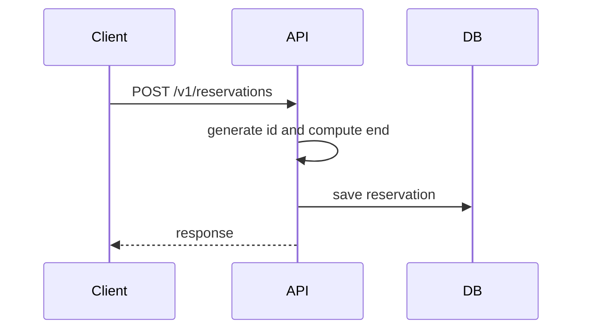

# English examples: API design

Stories and numbers in these examples are illustrations, not facts.

Requirement words in this document: **must**, **must not**, **should**, **may**. One word per level.

## Bad → good pairs

### 1. Vague performance

**Bad:** The API returns results quickly.
**Good:** The API must respond within 500 ms at P95.
(If no figure is known: mark `TBD-1` inline and add `- TBD-1: P95 target for this API?` under Open items.)

### 2. Vague error handling

**Bad:** The system handles out-of-stock errors appropriately.
**Good:** When an item is out of stock, the system returns 409 with the code `OUT_OF_STOCK` and does not create the order.

### 3. Vague authorization

**Bad:** Only users with appropriate permissions can perform this action.
**Good:** Only the roles `admin` and `staff` may call this API. Any other role receives 403.

### 4. Vague security

**Bad:** Data is stored securely.
**Good:** Passwords are stored as bcrypt hashes. The system must not store a plain-text password.

### 5. A process written as prose

**Bad:** First the system checks whether the cart is empty, and if it is not, it then proceeds to check the stock of each item, and if stock is sufficient, it creates the order and subsequently clears the cart.
**Good:**
1. The system checks that the cart is not empty.
2. The system checks stock for each line.
3. The system creates the order with status `PENDING`.
4. The system clears the cart.

### 6. Vague retry

**Bad:** If necessary, the system retries.
**Good:** When a call to the payment service fails, the system retries up to 3 times, 2 seconds apart. After the third failure, it returns 503.
(If the source gives no figure: mark `TBD-1` inline and add `- TBD-1: number of retries and delay?` under Open items.)

### 7. Input written as prose

**Bad:** The API accepts the necessary information such as the cart ID, the payment method and an optional note.
**Good:**

| Field | Direction | Type | Required | Constraint |
|---|---|---|---|---|
| `cart_id` | Request | uuid | Yes | The cart must belong to the caller |
| `payment_method` | Request | enum | Yes | `card`, `cod` |
| `note` | Request | string | No | at most 200 characters |

### 8. "etc."

**Bad:** Order status can be PENDING, PAID, etc.
**Good:** Order status is one of `PENDING`, `PAID`, `SHIPPED`, `CANCELLED`. If the source is incomplete: mark `TBD-1` inline and add `- TBD-1: full list of statuses?` under Open items.

### 9. Inconsistent terms

**Bad:** When a user creates an order, the system saves the purchase request into the orders table.
**Good:** When a user creates an order, the system saves the order into the `orders` table.
**Convention:** "order" in prose, `orders` as the table name. Never "purchase" or "request" for the same thing.

### 10. Writing a condition

**Bad:** In the event that the user has not logged in, access shall be denied.
**Good:** When the request has no valid token, the system must return 401.

### 11. Errors listed twice

**Bad:** Processing step 2 says "return 409 `ROOM_TAKEN` when the room is booked". The Errors table says the same again with different wording.
**Good:** Processing does not mention the booked room. The Errors table has one row: 409, `ROOM_TAKEN`, "Another reservation overlaps the slot".
**Fault:** Two owners for one fact drift apart.
**Fix:** The Errors table owns every check: condition, status and code. Processing lists no check.

### 12. Authorization listed three times

**Bad:** Identity says "staff only". Processing step 1 says "check that the caller is staff". Errors says "403 when the caller is not staff, as above".
**Good:** Identity says "Authorization: the roles `admin` and `staff`." Errors lists `403 FORBIDDEN` with the condition "the caller has another role". Processing does not mention roles.
**Fault:** Three places state one rule.
**Fix:** Identity owns the rule. Errors owns the failure.

### 13. "Same as siblings"

**Bad:** Errors: same as the other room endpoints.
**Good:** List every error of this endpoint in its own table. If the source is missing, put `TBD-1` in the table and add `- TBD-1: <question>` to Open items.
**Fault:** The reader cannot check the endpoint alone.
**Fix:** Write the rule here, or mark `TBD-1` and list `- TBD-1: <question>` in Open items.

### 14. A business rule with no step order

**Bad:** The system checks the overlap, the opening hours and the quota when it creates a reservation.
**Good:** Execution order: opening hours, overlap, daily quota. When two checks fail, the first failed check in this order decides the error.
**Fault:** The reader cannot tell which error wins when two checks fail.
**Fix:** Write one order line and one precedence line in Processing. When the brief gives no order, mark it `TBD-1` and add `- TBD-1: execution order and error precedence?` under Open items.

### 15. An empty-list case with no rule

**Bad:** The API returns the reservations of a room.
**Good:** The API returns the reservations of a room. When the room has none, it returns 200 with `items` as an empty array.
**Fault:** QA cannot tell 200 from 404 for an empty result.
**Fix:** Give the empty case its own sentence with a status.

### 16. Processing with steps and a diagram

**Bad:** A diagram alone, with no numbered steps. Or steps alone, for a flow with three branches.
**Good:** Numbered steps first, then one Mermaid block that shows the same order:

````markdown
1. The system generates `reservation_id`.
2. The system computes `ends_at` from `starts_at` and `minutes`.
3. The system saves the reservation with status `CONFIRMED`.


````

**Fault:** The diagram holds behavior that the steps do not state.
**Fix:** The steps own the rules. The diagram shows the order only.

### 17. Using TBD-n for a type given by the glossary

(The glossary defines `title` as "the title of the post".)

**Bad:**

| Field | Direction | Type | Required | Constraint |
|---|---|---|---|---|
| `title` | Request | `TBD-1` | Yes | — |

**Good:**

| Field | Direction | Type | Required | Constraint |
|---|---|---|---|---|
| `title` | Request | string | Yes | — |

**Fault:** Opening a `TBD-n` for a field type that the glossary already describes as text.
**Fix:** When the glossary describes a field as text (a title, a body, a name, or a part of a URL), write `string` and do not open a `TBD-n`.

### 18. A TBD-n that asks what the rule already says

(The brief says: `date` must be a date in the future, and a missing `date` has no error code.)

**Bad:** `- TBD-1: must the date be in the future?`
**Good:** ``- TBD-1: which HTTP status and code does the system return when `date` is missing?``
**Fault:** The question repeats a stated rule and skips the decision the brief lacks.
**Fix:** A `TBD-n` asks for the missing decision, here the error for a missing `date`.

### 19. Side effects with a sentence instead of the label

(The brief states no side effect.)

**Bad:** "No additional side effects are specified."
**Good:** `None`
**Fault:** A sentence around the label reads like an open question and is not the label in `profile.md`.
**Fix:** Write only the label `None` as the section text.

### 20. A speed rule with no number

(The brief says the API responds quickly and gives no time limit.)

**Bad:** The API must respond within 500 ms at P95.
**Good:** The API must respond within TBD-n. Open items: `- TBD-n: what is the time limit for a response?`
**Fault:** The number 500 ms is not in the source.
**Fix:** Write `TBD-n` with a question about the time limit. Number the marks `TBD-1`, `TBD-2` and so on.

## Complete filled API (reference shape)

````markdown
## Identity

- Method and path: `POST /v1/reservations`
- Purpose: create a reservation for one meeting room.
- Caller: the booking web app.
- Authorization: the roles `admin` and `staff`.
- Idempotency: not idempotent. A repeated call creates a second reservation.

## DTO and field mapping

| Field | Direction | Type | Required | Constraint |
|---|---|---|---|---|
| `room_id` | Request | uuid | Yes | The room must exist |
| `starts_at` | Request | datetime | Yes | The start must be in the future; at most `TBD-1` days ahead |
| `minutes` | Request | integer | Yes | 30 to 240, in steps of 30 |
| `note` | Request | string | No | at most 200 characters |
| `reservation_id` | Response | uuid | — | — |
| `status` | Response | string | — | — |
| `ends_at` | Response | datetime | — | — |

## Endpoint

Request:

    {"room_id": "r-12", "starts_at": "2026-12-01T09:00:00Z", "minutes": 60}

Response, status 201:

    {"reservation_id": "rv-88", "status": "CONFIRMED", "ends_at": "2026-12-01T10:00:00Z"}

## Processing

1. The system generates `reservation_id`.
2. The system computes `ends_at` from `starts_at` and `minutes`.
3. The system saves the reservation with status `CONFIRMED`.

Execution order of the checks: opening hours, then overlap. When two checks fail, the first in this order decides the error.

## Errors

| HTTP | Code | Condition |
|---|---|---|
| 400 | `OUTSIDE_HOURS` | The slot lies outside opening hours |
| 403 | `FORBIDDEN` | The caller has another role |
| 409 | `ROOM_TAKEN` | Another reservation overlaps the slot |

## Side effects

The system writes one audit record for each saved reservation.

## Open items

- `TBD-1`: how many days ahead may a caller reserve?
````

## Your own samples

<!-- Paste one API you filled in well. The AI learns from this more than from any description. -->
