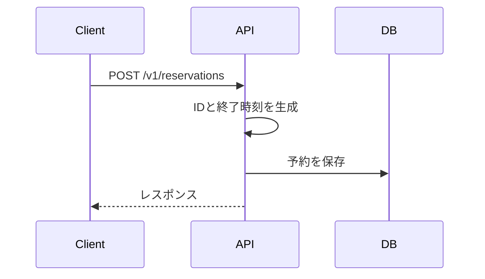

# 日本語の例: API設計(である調 / 常体)

この例の物語と数字は説明用の例であり、事実ではない。

要件の強さを示す語は **〜しなければならない**(必須)、**〜してはならない**(禁止)、**〜することが望ましい**(推奨)、**〜してもよい**(任意)の4つ。1段階に1つの言い方を使う。
既定の動作は、素直に「〜する」と書いてよい。チームの慣習があれば、それに従う。

## Bad → Good

### 1. あいまいな性能

**Bad:** APIは迅速に結果を返す。
**Good:** APIは、P95で500ミリ秒以内に応答しなければならない。
(目標値が不明な場合: 本文に `TBD-1` と書き、未決事項に `- TBD-1: このAPIのP95の目標値は?` を置く)

### 2. あいまいなエラー処理

**Bad:** 在庫切れの場合は、適切にエラー処理を行う。
**Good:** 商品が在庫切れの場合、システムはHTTP 409とエラーコード `OUT_OF_STOCK` を返す。注文は作成しない。

### 3. あいまいな権限

**Bad:** 適切な権限を持つユーザーのみが操作を実行できる。
**Good:** ロール `admin` と `staff` のみが、本APIを呼び出せる。それ以外のロールには、HTTP 403を返す。

### 4. あいまいなセキュリティ

**Bad:** データは安全に保管される。
**Good:** パスワードはbcryptでハッシュ化して保存する。平文のパスワードを保存してはならない。

### 5. 処理を1つの長い文で書く

**Bad:** まず、カートが空でないかどうかの確認を行い、その後、空でない場合には各商品の在庫確認を行い、十分であれば注文を作成した上でカートを削除する。
**Good:**
1. システムは、カートが空でないことを確認する。
2. システムは、明細ごとに在庫を確認する。
3. システムは、ステータス `PENDING` の注文を作成する。
4. システムは、カートを削除する。

### 6. あいまいなリトライ

**Bad:** 必要に応じてリトライする。
**Good:** 決済サービスの呼び出しに失敗した場合、システムは2秒間隔で最大3回リトライする。3回を超えた場合は、HTTP 503を返す。
(情報源に数字がない場合: 本文に `TBD-1` と書き、未決事項に `- TBD-1: リトライの回数と間隔は?` を置く)

### 7. 入力を文章で書く

**Bad:** APIは、カートID、支払方法、備考(任意)などの必要な情報を受け取る。
**Good:**

| 項目 | 方向 | 型 | 必須 | 制約 |
|---|---|---|---|---|
| `cart_id` | リクエスト | uuid | 必須 | 呼び出し元のカートであること |
| `payment_method` | リクエスト | enum | 必須 | `card`, `cod` |
| `note` | リクエスト | string | 任意 | 200文字以内 |

### 8. 「等」

**Bad:** 注文ステータスは PENDING、PAID 等とする。
**Good:** 注文ステータスは `PENDING`、`PAID`、`SHIPPED`、`CANCELLED` の4つとする。
(情報源が不完全な場合: 本文に `TBD-1` と書き、未決事項に `- TBD-1: ステータスの全一覧は?` を置く)

### 9. 用語の不統一

**Bad:** ユーザーがオーダーを作成すると、注文データをordersテーブルに保存する。
**Good:** ユーザーが注文を作成すると、注文をordersテーブルに保存する。
**Convention:** 文章では「注文」、テーブル名では `orders`。同じ物に「オーダー」「発注」を混ぜない。

### 10. 条件の書き方

**Bad:** ログインしていない場合はアクセスが許可されないことになっている。
**Good:** リクエストに有効なトークンがない場合、システムはHTTP 401を返さなければならない。

### 11. エラーを2回書く

**Bad:** 処理のステップ2に「部屋が予約済みならHTTP 409 `ROOM_TAKEN` を返す」と書く。エラー表にも別の言い方で同じ内容を書く。
**Good:** 処理には予約済みの部屋の確認を書かない。エラー表に1行だけ書く。409、`ROOM_TAKEN`、「別の予約が時間帯と重なる」。
**Fault:** 1つの事実を2か所に書くと、後でずれる。
**Fix:** すべての確認は、エラー表が持つ。条件、HTTPステータス、コードをそこに書く。処理には確認を並べない。

### 12. 権限を3回書く

**Bad:** 識別情報に「staffのみ」と書く。処理のステップ1に「呼び出し元がstaffか確認する」と書く。エラー表にも「staffでない場合は403、上記のとおり」と書く。
**Good:** 識別情報に「認可: ロール `admin` と `staff`」と書く。エラー表に、条件「呼び出し元が別のロールである」で `403 FORBIDDEN` を書く。処理にはロールを書かない。
**Fault:** 1つの規則を3か所に書いている。
**Fix:** 識別情報が規則を持つ。エラー表が失敗の場合を持つ。

### 13. 「他と同じ」

**Bad:** エラー: 他の会議室APIと同じ。
**Good:** このAPIのエラーを、専用の表にすべて書く。情報源にない場合は表に `TBD-1` と書き、未決事項に `- TBD-1: <質問>` を置く。
**Fault:** 読み手は、そのAPI単体では確認できない。
**Fix:** 規則をここに書く。または `TBD-1` と書き、未決事項に `- TBD-1: <質問>` を置く。

### 14. 手順の順序がない業務ルール

**Bad:** システムは、予約を作成するときに、重複、営業時間、上限を確認する。
**Good:** 確認の順序: 営業時間、重複、1日の上限。2つの確認が失敗した場合は、この順で最初に失敗した確認がエラーを決める。
**Fault:** 2つの確認が失敗したとき、どのエラーを返すか分からない。
**Fix:** 処理に、順序の行と優先順の行を1行ずつ書く。仕様に順序がない場合は `TBD-1` とし、未決事項に `- TBD-1: 処理順とエラーの優先順は?` を置く。

### 15. 空の一覧の規則がない

**Bad:** APIは、部屋の予約を返す。
**Good:** APIは、部屋の予約を返す。部屋に予約がない場合は、HTTP 200で、`items` を空の配列にして返す。
**Fault:** 結果が空のとき、200か404かをQAが判断できない。
**Fix:** 空の場合を、ステータス付きの別の文にする。

### 16. 手順とシーケンス図を持つ処理

**Bad:** 番号付きの手順がなく、図だけがある。または、3つの分岐がある流れに手順だけがある。
**Good:** 先に番号付きの手順を書き、次に同じ順序を示すMermaidのブロックを1つ置く。

````markdown
1. システムは、`reservation_id` を生成する。
2. システムは、`starts_at` と `minutes` から `ends_at` を計算する。
3. システムは、ステータス `CONFIRMED` で予約を保存する。


````

**Fault:** 図が、手順にない動作を持っている。
**Fix:** 規則は手順が持つ。図は順序だけを示す。

### 17. 用語集で型が分かる項目に TBD-n を書く

(用語集に `title` は「記事のタイトル」とある。)

**Bad:**

| 項目 | 方向 | 型 | 必須 | 制約 |
|---|---|---|---|---|
| `title` | リクエスト | `TBD-1` | 必須 | なし |

**Good:**

| 項目 | 方向 | 型 | 必須 | 制約 |
|---|---|---|---|---|
| `title` | リクエスト | string | 必須 | なし |

**Fault:** 用語集がテキストと説明している項目の型に `TBD-n` を開いている。
**Fix:** 用語集がテキスト(タイトル、本文、名前、URLの一部)を示す場合は `string` と書き、`TBD-n` を開かない。

### 18. 規則がすでに示す内容を TBD-n で聞く

(仕様に「`date` は未来の日付でなければならない」とある。`date` が欠けた場合のエラーは書かれていない。)

**Bad:** `- TBD-1: 日付は未来でなければならないか?`
**Good:** `` - TBD-1: `date` が欠けた場合、システムはどのHTTPステータスとコードを返すか? ``
**Fault:** 質問が、書かれた規則を繰り返し、仕様に欠けている決定を聞いていない。
**Fix:** `TBD-n` は欠けている決定を聞く。ここでは、`date` が欠けた場合のエラーである。

### 19. 副作用をラベルではなく文で書く

(仕様に副作用の記載がない。)

**Bad:** 「副作用は仕様に記載されていない。」
**Good:** `なし`
**Fault:** ラベルの周りの文は未決事項のように読め、`profile.md` のラベルでもない。
**Fix:** 本文はラベル `なし` だけにする。

### 20. 数字のない速度の規則

(素材には「APIは速く応答する」とあるだけで、時間の上限はない。)

**Bad:** APIは95パーセンタイルで500ミリ秒以内に応答しなければならない。
**Good:** APIはTBD-n以内に応答しなければならない。未決事項: `- TBD-n: 応答時間の上限はいくらか。`
**Fault:** 500ミリ秒という数字は素材にない。
**Fix:** `TBD-n` と、時間の上限についての質問を書く。印は `TBD-1`、`TBD-2` のように番号を振る。

## 完成見本(参考の形。構造は `SKILL.md` の api-design の節が決める)

````markdown
## 識別情報

- メソッドとパス: `POST /v1/reservations`
- 目的: 会議室1室の予約を作成する。
- 呼び出し元: 予約用のWebアプリ。
- 認可: ロール `admin` と `staff`。
- 冪等性: 冪等ではない。再度呼ぶと、予約をもう1件作成する。

## DTOとフィールド対応

| 項目 | 方向 | 型 | 必須 | 制約 |
|---|---|---|---|---|
| `room_id` | リクエスト | uuid | 必須 | 部屋が存在すること |
| `starts_at` | リクエスト | datetime | 必須 | 開始が未来であること。予約は `TBD-1` 日先まで |
| `minutes` | リクエスト | integer | 必須 | 30以上240以下、30刻み |
| `note` | リクエスト | string | 任意 | 200文字以内 |
| `reservation_id` | レスポンス | uuid | なし | なし |
| `status` | レスポンス | string | なし | なし |
| `ends_at` | レスポンス | datetime | なし | なし |

## エンドポイント

リクエスト:

    {"room_id": "r-12", "starts_at": "2026-12-01T09:00:00Z", "minutes": 60}

レスポンス。ステータス201:

    {"reservation_id": "rv-88", "status": "CONFIRMED", "ends_at": "2026-12-01T10:00:00Z"}

## 処理

1. システムは、`reservation_id` を生成する。
2. システムは、`starts_at` と `minutes` から `ends_at` を計算する。
3. システムは、ステータス `CONFIRMED` で予約を保存する。

確認の順序: 営業時間、重複。2つの確認が失敗した場合は、この順で最初に失敗した確認がエラーを決める。

## エラー

| HTTP | コード | 条件 |
|---|---|---|
| 400 | `OUTSIDE_HOURS` | 時間帯が営業時間外である |
| 403 | `FORBIDDEN` | 呼び出し元が別のロールである |
| 409 | `ROOM_TAKEN` | 別の予約が時間帯と重なる |

## 副作用

システムは、保存した予約ごとに監査記録を1件書く。

## 未決事項

- `TBD-1`: 呼び出し元は、何日先まで予約できるか?
````

## あなた自身のサンプル

<!-- きちんと書けたAPIを1つ貼る。AIは、どんな説明よりもこれから学ぶ。 -->
