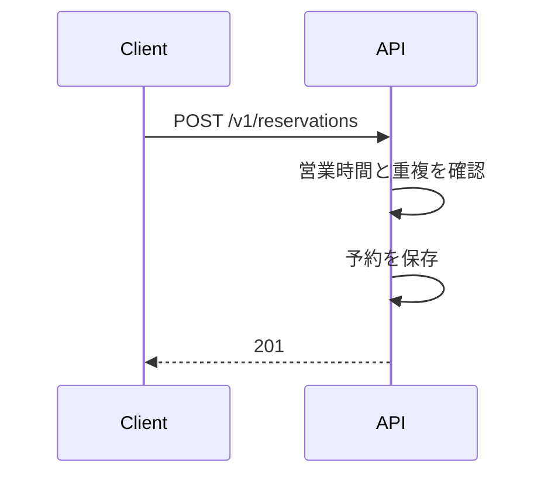

# 日本語の例: API設計(である調 / 常体)

この例の物語と数字は説明用の例であり、事実ではない。

要件の強さを示す語は **〜しなければならない**(必須)、**〜してはならない**(禁止)、**〜することが望ましい**(推奨)、**〜してもよい**(任意)の4つ。1段階に1つの言い方を使う。
既定の動作は、素直に「〜する」と書いてよい。チームの慣習があれば、それに従う。

## Bad → Good

### 1. あいまいな性能

**Bad:** APIは迅速に結果を返す。
**Good:** APIは、P95で500ミリ秒以内に応答しなければならない。
(目標値が不明な場合: 本文に `TBD-1` と書き、未決事項に `- TBD-1: このAPIのP95の目標値は?` を置く)

### 2. あいまいなエラー処理

**Bad:** 在庫切れの場合は、適切にエラー処理を行う。
**Good:** 商品が在庫切れの場合、システムはHTTP 409とエラーコード `OUT_OF_STOCK` を返す。注文は作成しない。

### 3. あいまいな権限

**Bad:** 適切な権限を持つユーザーのみが操作を実行できる。
**Good:** ロール `admin` と `staff` のみが、本APIを呼び出せる。それ以外のロールには、HTTP 403を返す。

### 4. あいまいなセキュリティ

**Bad:** データは安全に保管される。
**Good:** パスワードはbcryptでハッシュ化して保存する。平文のパスワードを保存してはならない。

### 5. 処理を1つの長い文で書く

**Bad:** まず、カートが空でないかどうかの確認を行い、その後、空でない場合には各商品の在庫確認を行い、十分であれば注文を作成した上でカートを削除する。
**Good:**
1. システムは、カートが空でないことを確認する。
2. システムは、明細ごとに在庫を確認する。
3. システムは、ステータス `PENDING` の注文を作成する。
4. システムは、カートを削除する。

### 6. あいまいなリトライ

**Bad:** 必要に応じてリトライする。
**Good:** 決済サービスの呼び出しに失敗した場合、システムは2秒間隔で最大3回リトライする。3回を超えた場合は、HTTP 503を返す。
(情報源に数字がない場合: 本文に `TBD-1` と書き、未決事項に `- TBD-1: リトライの回数と間隔は?` を置く)

### 7. 入力を文章で書く

**Bad:** APIは、カートID、支払方法、備考(任意)などの必要な情報を受け取る。
**Good:**

| 項目 | 型 | 必須 | 制約 |
|---|---|---|---|
| `cart_id` | uuid | 必須 | 呼び出し元のカートであること |
| `payment_method` | enum | 必須 | `card`, `cod` |
| `note` | string | 任意 | 200文字以内 |

### 8. 「等」

**Bad:** 注文ステータスは PENDING、PAID 等とする。
**Good:** 注文ステータスは `PENDING`、`PAID`、`SHIPPED`、`CANCELLED` の4つとする。
(情報源が不完全な場合: 本文に `TBD-1` と書き、未決事項に `- TBD-1: ステータスの全一覧は?` を置く)

### 9. 用語の不統一

**Bad:** ユーザーがオーダーを作成すると、注文データをordersテーブルに保存する。
**Good:** ユーザーが注文を作成すると、注文をordersテーブルに保存する。
**Convention:** 文章では「注文」、テーブル名では `orders`。同じ物に「オーダー」「発注」を混ぜない。

### 10. 条件の書き方

**Bad:** ログインしていない場合はアクセスが許可されないことになっている。
**Good:** リクエストに有効なトークンがない場合、システムはHTTP 401を返さなければならない。

### 11. エラーを2回書く

**Bad:** 処理のステップ2に「部屋が予約済みならHTTP 409 `ROOM_TAKEN` を返す」と書く。エラー表にも別の言い方で同じ内容を書く。
**Good:** 処理のステップ2は「部屋が予約済みの場合、`ROOM_TAKEN` で止める」と書く。HTTPステータス409と条件は、エラー表だけに書く。
**Fault:** 1つの事実を2か所に書くと、後でずれる。
**Fix:** 処理はコードの名前だけを書く。エラー表がステータスと条件を持つ。

### 12. 権限を3回書く

**Bad:** 識別情報に「staffのみ」と書く。処理のステップ1に「呼び出し元がstaffか確認する」と書く。エラー表にも「staffでない場合は403、上記のとおり」と書く。
**Good:** 識別情報に「認可: ロール `admin` と `staff`」と書く。エラー表に、条件「呼び出し元が別のロールである」で `403 FORBIDDEN` を書く。処理にはロールを書かない。
**Fault:** 1つの規則を3か所に書いている。
**Fix:** 識別情報が規則を持つ。エラー表が失敗の場合を持つ。

### 13. 「他と同じ」

**Bad:** エラー: 他の会議室APIと同じ。
**Good:** このAPIのエラーを、専用の表にすべて書く。情報源にない場合は表に `TBD-1` と書き、未決事項に `- TBD-1: <質問>` を置く。
**Fault:** 読み手は、そのAPI単体では確認できない。
**Fix:** 規則をここに書く。または `TBD-1` と書き、未決事項に `- TBD-1: <質問>` を置く。

### 14. 手順の順序がない業務ルール

**Bad:** システムは、予約を作成するときに、重複、営業時間、上限を確認する。
**Good:**
1. システムは、時間帯が営業時間内であることを確認する。
2. システムは、時間帯が重なる予約がないことを確認する。
3. システムは、呼び出し元が1日の上限以内であることを確認する。
4. システムは、予約を保存する。
**Fault:** 2つの確認が失敗したとき、どのエラーを返すか分からない。
**Fix:** 仕様に順序があるときだけ番号を付ける。順序がない場合は箇条書きにし、優先順を `TBD-1` とし、未決事項に `- TBD-1: 処理順とエラーの優先順は?` を置く。

### 15. 空の一覧の規則がない

**Bad:** APIは、部屋の予約を返す。
**Good:** APIは、部屋の予約を返す。部屋に予約がない場合は、HTTP 200で、`items` を空の配列にして返す。
**Fault:** 結果が空のとき、200か404かをQAが判断できない。
**Fix:** 空の場合を、ステータス付きの別の文にする。

### 16. 手順とシーケンス図を持つ処理

**Bad:** 番号付きの手順がなく、図だけがある。または、3つの分岐がある流れに手順だけがある。
**Good:** 先に番号付きの手順を書き、次に同じ順序を示すMermaidのブロックを1つ置く。

````markdown
1. システムは、時間帯が営業時間内であることを確認する。
2. システムは、時間帯が重なる予約がないことを確認する。
3. システムは、予約を保存する。


````

**Fault:** 図が、手順にない規則を持っている。
**Fix:** 規則は手順が持つ。図は順序だけを示す。

### 17. 用語集で型が分かる項目に TBD-n を書く

(用語集に `title` は「記事のタイトル」とある。)

**Bad:**

| 項目 | 型 | 必須 | 制約 |
|---|---|---|---|
| `title` | `TBD-1` | 必須 | — |

**Good:**

| 項目 | 型 | 必須 | 制約 |
|---|---|---|---|
| `title` | string | 必須 | — |

**Fault:** 用語集がテキストと説明している項目の型に `TBD-n` を開いている。
**Fix:** 用語集がテキスト(タイトル、本文、名前、URLの一部)を示す場合は `string` と書き、`TBD-n` を開かない。

## 完成見本(参考の形。構造は `doc-types/api-design.md` が決める)

````markdown
## 識別情報

- メソッドとパス: `POST /v1/reservations`
- 目的: 会議室1室の予約を作成する。
- 呼び出し元: 予約用のWebアプリ。
- 認可: ロール `admin` と `staff`。
- 冪等性: 冪等ではない。再度呼ぶと、予約をもう1件作成する。

## DTOとフィールド対応

| 項目 | 型 | 必須 | 制約 |
|---|---|---|---|
| `room_id` | uuid | 必須 | 部屋が存在すること |
| `starts_at` | datetime | 必須 | 開始が未来であること。予約は `TBD-1` 日先まで |
| `minutes` | integer | 必須 | 30以上240以下、30刻み |
| `note` | string | 任意 | 200文字以内 |

レスポンスの項目: `reservation_id`(uuid)、`status`(string)、`ends_at`(datetime)。

## エンドポイント

リクエスト:

    {"room_id": "r-12", "starts_at": "2026-12-01T09:00:00Z", "minutes": 60}

レスポンス。ステータス201:

    {"reservation_id": "rv-88", "status": "CONFIRMED", "ends_at": "2026-12-01T10:00:00Z"}

## 処理

1. システムは、時間帯が営業時間内であることを確認する。
2. システムは、時間帯が重なる予約がないことを確認する。ある場合は `ROOM_TAKEN` で止める。
3. システムは、ステータス `CONFIRMED` で予約を保存する。


## エラー

| HTTP | コード | 条件 |
|---|---|---|
| 400 | `OUTSIDE_HOURS` | 時間帯が営業時間外である |
| 403 | `FORBIDDEN` | 呼び出し元が別のロールである |
| 409 | `ROOM_TAKEN` | 別の予約が時間帯と重なる |

## 副作用

システムは、保存した予約ごとに監査記録を1件書く。

## 未決事項

- `TBD-1`: 呼び出し元は、何日先まで予約できるか?
````

## あなた自身のサンプル

<!-- きちんと書けたAPIを1つ貼る。AIは、どんな説明よりもこれから学ぶ。 -->
