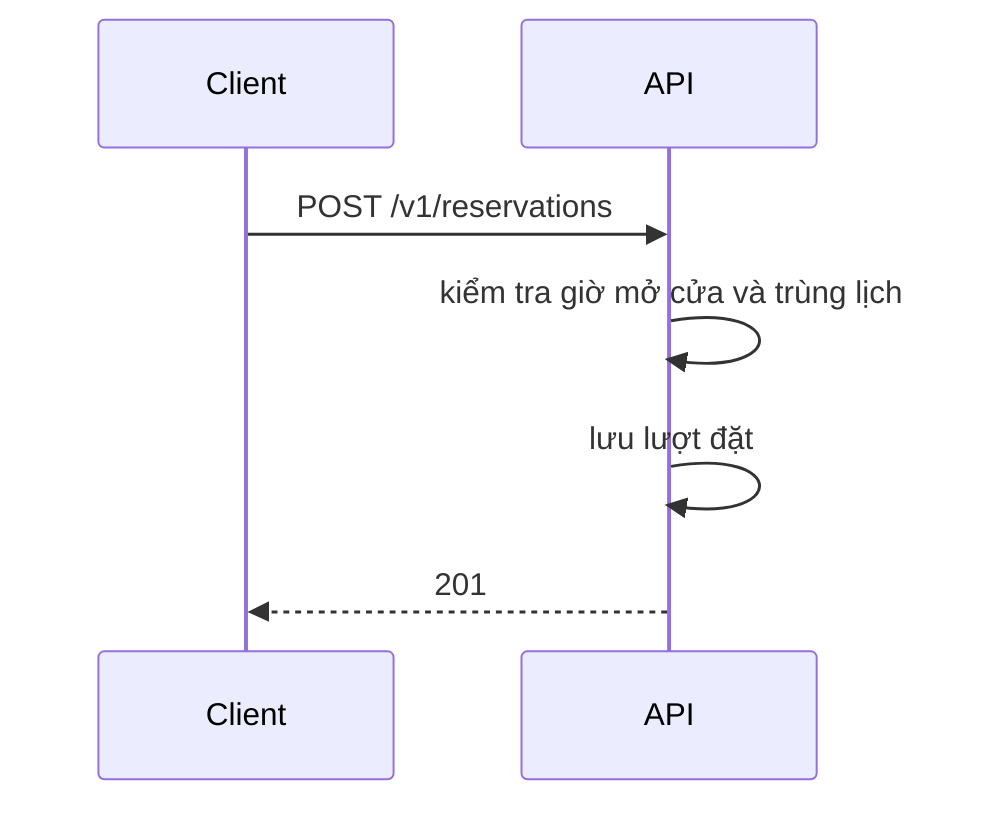

# Ví dụ tiếng Việt: API design

Câu chuyện và con số trong các ví dụ chỉ để minh họa, không phải sự thật.

Mẫu riêng cho tiếng Việt. Cấu trúc nằm trong `doc-types/`, ngưỡng nằm trong `profile.json`.

## Bad → good pairs

### 1. Hiệu năng mơ hồ

**Bad:** API trả kết quả một cách nhanh chóng.
**Good:** API phải trả lời trong ≤ 500 ms ở P95. (Nếu chưa có số: `TBD: ngưỡng P95 cho API này?`)

### 2. Xử lý lỗi mơ hồ

**Bad:** Hệ thống xử lý lỗi một cách phù hợp khi sản phẩm hết hàng.
**Good:** Khi một sản phẩm hết hàng, hệ thống trả 409 với mã `OUT_OF_STOCK` và không tạo đơn hàng.

### 3. Phân quyền mơ hồ

**Bad:** Chỉ người dùng có quyền thích hợp mới được thực hiện thao tác này.
**Good:** Chỉ role `admin` và `staff` được gọi API này. Role khác nhận 403.

### 4. Bảo mật mơ hồ

**Bad:** Dữ liệu được lưu trữ một cách an toàn.
**Good:** Mật khẩu lưu dạng hash bcrypt. Hệ thống không được lưu mật khẩu gốc.

### 5. Quy trình bằng văn xuôi

**Bad:** Đầu tiên hệ thống sẽ tiến hành kiểm tra xem giỏ hàng có rỗng hay không, sau đó nếu không rỗng thì sẽ kiểm tra tồn kho của từng sản phẩm và nếu đủ thì tạo đơn hàng rồi xóa giỏ hàng.
**Good:**
1. Hệ thống kiểm tra giỏ hàng không rỗng.
2. Hệ thống kiểm tra tồn kho từng dòng.
3. Hệ thống tạo đơn hàng, trạng thái `PENDING`.
4. Hệ thống xóa giỏ hàng.

### 6. Thử lại mơ hồ

**Bad:** Nếu cần thì hệ thống sẽ thử lại.
**Good:** Khi gọi dịch vụ thanh toán thất bại, hệ thống thử lại tối đa 3 lần, cách nhau 2 giây. Quá 3 lần, hệ thống trả 503.
(Nếu nguồn không nêu số lần: `TBD: số lần và khoảng cách thử lại?`)

### 7. Đầu vào bằng văn xuôi

**Bad:** API nhận vào các thông tin cần thiết như mã giỏ hàng, phương thức thanh toán và ghi chú nếu có.
**Good:**

| Trường | Kiểu | Bắt buộc | Ràng buộc |
|---|---|---|---|
| `cart_id` | uuid | Có | Giỏ phải thuộc người gọi |
| `payment_method` | enum | Có | `card`, `cod` |
| `note` | string | Không | ≤ 200 ký tự |

### 8. "v.v."

**Bad:** Trạng thái đơn hàng gồm PENDING, PAID, v.v.
**Good:** Trạng thái đơn hàng gồm `PENDING`, `PAID`, `SHIPPED`, `CANCELLED`. Nếu nguồn chưa đủ: `TBD: danh sách đầy đủ trạng thái?`

### 9. Thuật ngữ không nhất quán

**Bad:** Khi người dùng tạo order, hệ thống lưu đơn đặt hàng vào bảng orders.
**Good:** Khi người dùng tạo đơn hàng, hệ thống lưu đơn hàng vào bảng `orders`.
**Convention:** "đơn hàng" trong văn bản, `orders` trong tên bảng. Không dùng "order" hay "đơn đặt hàng" cho cùng một khái niệm.

### 10. Mô tả điều kiện

**Bad:** Trong trường hợp mà người dùng chưa đăng nhập thì sẽ không được phép truy cập.
**Good:** Khi request không có token hợp lệ, hệ thống phải trả 401.

### 11. Lỗi liệt kê hai lần

**Bad:** Bước 2 của Xử lý ghi "trả 409 `ROOM_TAKEN` khi phòng đã có người đặt". Bảng Lỗi ghi lại điều đó bằng lời khác.
**Good:** Bước 2 ghi "Nếu phòng đã có người đặt, dừng và trả lỗi `ROOM_TAKEN`." Chỉ bảng Lỗi nêu mã HTTP 409 và điều kiện.
**Fault:** Hai nơi giữ một sự thật sẽ lệch nhau.
**Fix:** Xử lý chỉ gọi tên mã. Bảng Lỗi giữ mã HTTP và điều kiện.

### 12. Phân quyền ghi ba lần

**Bad:** Danh tính ghi "chỉ staff". Bước 1 của Xử lý ghi "kiểm tra người gọi là staff". Bảng Lỗi ghi "403 khi người gọi không phải staff, như trên".
**Good:** Danh tính ghi "Phân quyền: role `admin` và `staff`." Bảng Lỗi ghi `403 FORBIDDEN` với điều kiện "người gọi có role khác". Xử lý không nhắc đến role.
**Fault:** Ba nơi nêu một quy tắc.
**Fix:** Danh tính giữ quy tắc. Bảng Lỗi giữ trường hợp thất bại.

### 13. "Giống các API cùng nhóm"

**Bad:** Lỗi: giống các endpoint phòng họp khác.
**Good:** Liệt kê mọi lỗi của endpoint này trong bảng riêng. Nếu nguồn thiếu, ghi `TBD` trong bảng và đưa câu hỏi vào mục còn mở.
**Fault:** Người đọc không thể kiểm tra endpoint một mình.
**Fix:** Ghi quy tắc ngay tại đây, hoặc ghi `TBD` rồi đưa câu hỏi vào mục còn mở.

### 14. Quy tắc nghiệp vụ không có thứ tự bước

**Bad:** Hệ thống kiểm tra trùng lịch, giờ mở cửa và hạn mức khi tạo lượt đặt.
**Good:**
1. Hệ thống kiểm tra khung giờ nằm trong giờ mở cửa.
2. Hệ thống kiểm tra không có lượt đặt nào trùng khung giờ.
3. Hệ thống kiểm tra người gọi chưa vượt hạn mức trong ngày.
4. Hệ thống lưu lượt đặt.
**Fault:** Người đọc không biết lỗi nào trả trước khi hai bước cùng thất bại.
**Fix:** Đánh số các bước khi brief nêu rõ thứ tự; nếu chưa rõ, dùng gạch đầu dòng và ghi thứ tự ưu tiên là `TBD`.

### 15. Danh sách rỗng không có quy tắc

**Bad:** API trả các lượt đặt của một phòng.
**Good:** API trả các lượt đặt của một phòng. Khi phòng chưa có lượt nào, API trả 200 với `items` là mảng rỗng.
**Fault:** QA không biết kết quả rỗng là 200 hay 404.
**Fix:** Viết trường hợp rỗng thành một câu riêng, kèm mã HTTP.

### 16. Xử lý có bước và sơ đồ

**Bad:** Chỉ có sơ đồ, không có bước đánh số. Hoặc chỉ có bước, trong luồng có ba nhánh.
**Good:** Bước đánh số trước, rồi một khối Mermaid cho cùng thứ tự:

````markdown
1. Hệ thống kiểm tra khung giờ nằm trong giờ mở cửa.
2. Hệ thống kiểm tra không có lượt đặt nào trùng khung giờ.
3. Hệ thống lưu lượt đặt.


````

**Fault:** Sơ đồ chứa quy tắc mà các bước không nêu.
**Fix:** Các bước giữ quy tắc. Sơ đồ chỉ cho thấy thứ tự.

## Mẫu API điền hoàn chỉnh

Khuôn tham khảo. Cấu trúc nằm trong `doc-types/api-design.md`.

````markdown
## Danh tính

- Method và path: `POST /v1/reservations`
- Mục đích: tạo lượt đặt cho một phòng họp.
- Bên gọi: web app đặt phòng.
- Phân quyền: role `admin` và `staff`.
- Idempotency: không idempotent. Gọi lại tạo thêm một lượt đặt.

## DTO và ánh xạ trường

| Trường | Kiểu | Bắt buộc | Ràng buộc |
|---|---|---|---|
| `room_id` | uuid | Có | Phòng phải tồn tại |
| `starts_at` | datetime | Có | Giờ bắt đầu phải ở tương lai |
| `minutes` | integer | Có | 30 đến 240, bước 30 |
| `note` | string | Không | ≤ 200 ký tự |

Trường trả về: `reservation_id` (uuid), `status` (string), `ends_at` (datetime).

## Endpoint

Request:

    {"room_id": "r-12", "starts_at": "2026-12-01T09:00:00Z", "minutes": 60}

Response, status 201:

    {"reservation_id": "rv-88", "status": "CONFIRMED", "ends_at": "2026-12-01T10:00:00Z"}

## Xử lý

1. Hệ thống kiểm tra khung giờ nằm trong giờ mở cửa.
2. Hệ thống kiểm tra không có lượt đặt nào trùng khung giờ. Nếu có, dừng với `ROOM_TAKEN`.
3. Hệ thống lưu lượt đặt với trạng thái `CONFIRMED`.


## Lỗi

| HTTP | Mã | Điều kiện |
|---|---|---|
| 400 | `OUTSIDE_HOURS` | Khung giờ nằm ngoài giờ mở cửa |
| 403 | `FORBIDDEN` | Người gọi có role khác |
| 409 | `ROOM_TAKEN` | Một lượt đặt khác trùng khung giờ |

## Tác dụng phụ

Hệ thống ghi một bản ghi audit cho mỗi lượt đặt được lưu.

## Mục còn mở

- `TBD`: người gọi được đặt trước tối đa bao nhiêu ngày?
````

## Mẫu của bạn (thêm vào đây)

<!-- Dán một API bạn đã điền chuẩn. AI học từ đây tốt hơn học từ mọi lời mô tả. -->
